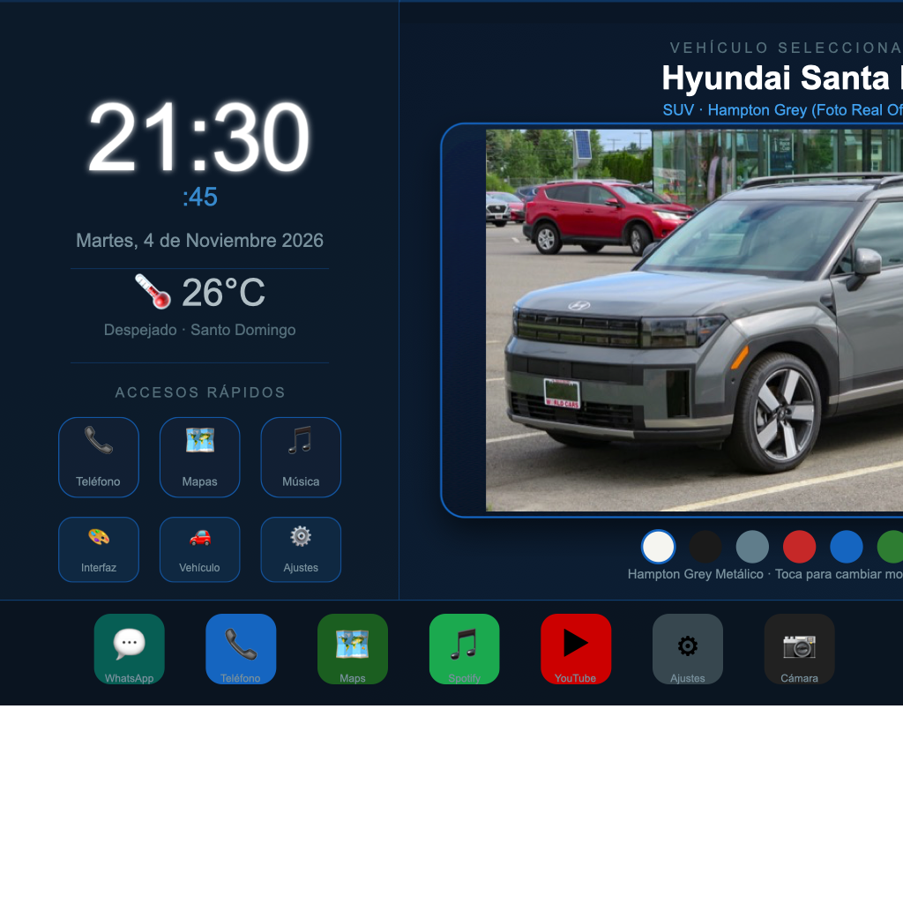
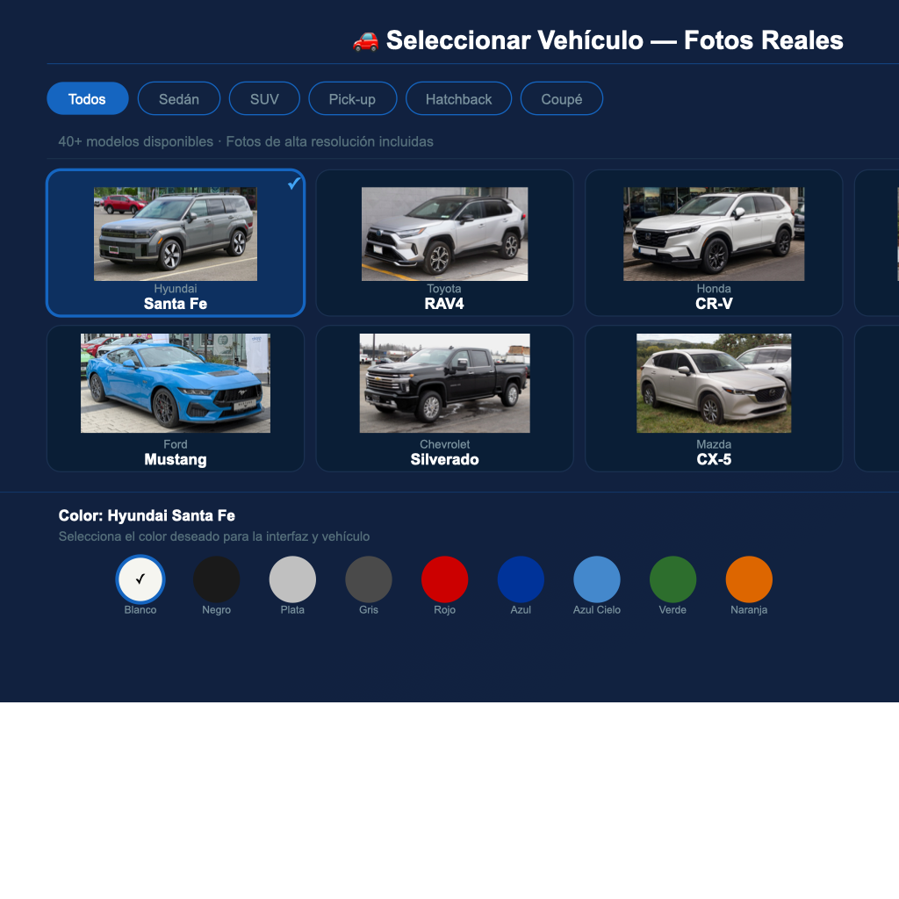
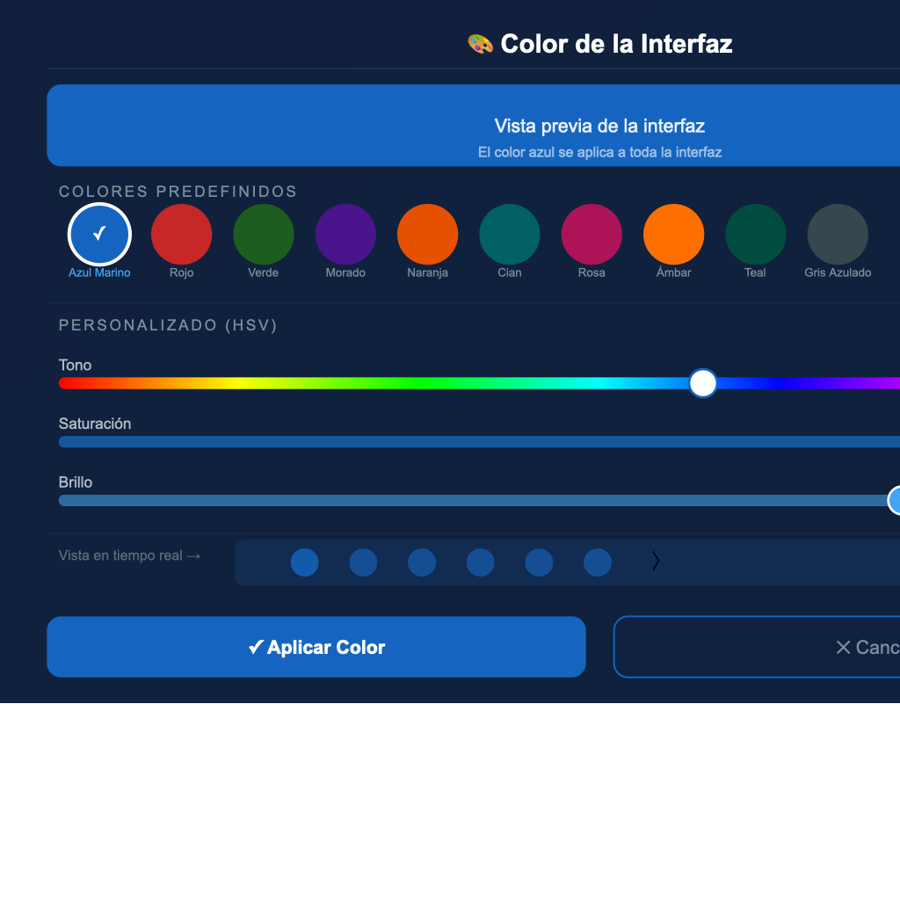
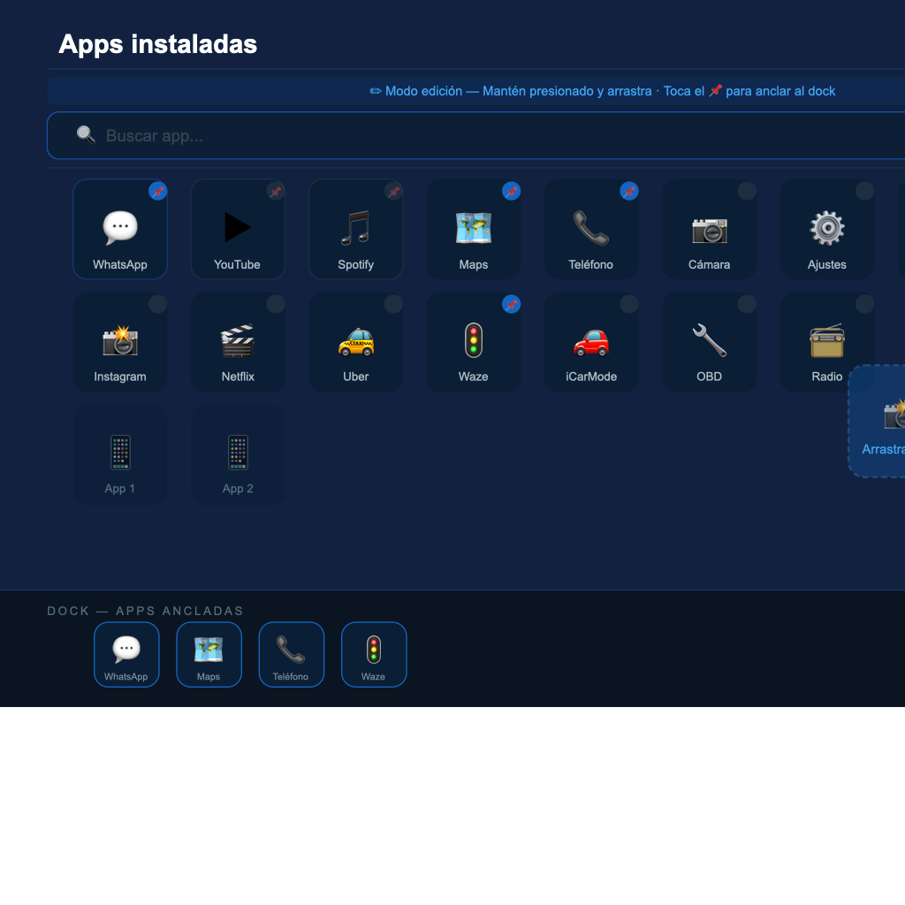

<p align="center">
  
</p>

<h1 align="center">CARPERSO</h1>
<p align="center">
  <strong>Launcher personalizable para radios de auto (Android Head Units)</strong><br/>
  Diseñado para radios chinas con Android 7+ · Pantallas 1024×600 a 2000×1200
</p>

<p align="center">
  
  
  
  
  
  
</p>

---

## 📸 Capturas de pantalla

### 🏠 Pantalla Principal
> Reloj, fecha, accesos rápidos, vehículo seleccionado con fotos reales offline (ejemplo Hyundai Santa Fe) y dock inferior



---

### 🚗 Selector de Vehículo y Color
> Más de 40 modelos comerciales con fotos reales integradas offline (Hyundai Santa Fe, RAV4, CR-V, Sorento, Mustang, Silverado, CX-5, Model 3...)



---

### 🎨 Selector de Color de Interfaz
> Colores predefinidos + sliders HSV para personalización total



---

### 📱 Cajón de Aplicaciones
> Grid reordenable con arrastre, búsqueda, modo edición y anclado al dock



---

## ✨ Funcionalidades

| Función | Descripción |
|---------|-------------|
| 🏠 **Launcher HOME** | Reemplaza la pantalla de inicio del sistema — sin root |
| 🚗 **40+ modelos** | Hyundai Santa Fe, Tucson, Elantra, Toyota RAV4, Corolla, Hilux, Fortuner, Honda Civic, CR-V, Accord, Ford Mustang, F-150, Explorer, Tahoe, Silverado, Kia Sorento, Sportage, Mazda CX-5, Jeep Grand Cherokee, Tesla Model 3 y más |
| 📸 **Fotos reales** | Fotos reales de alta definición integradas offline (funcionan 100% sin conexión a internet) |
| 🎨 **Color de interfaz** | 10 presets + selector HSV completo — cambia todo el tema en tiempo real |
| 🖌️ **Color del vehículo** | Blanco perla, negro obsidiana, plata, rojo, azul marino, verde, naranja y más |
| 📱 **Cajón de apps** | Grid 5 columnas con búsqueda, reordenamiento por arrastre |
| 📌 **Dock personalizable** | Ancla tus apps favoritas al dock inferior — reordénalas |
| 🌙 **Tema oscuro** | Optimizado para conducir de noche — fondo oscuro por defecto |
| 💾 **Persistencia** | Todo se guarda con DataStore — survives reboots |
| ⚡ **Sin internet** | Funciona completamente offline |

---

## 📋 Vehículos disponibles

<details>
<summary><strong>Sedanes (11 modelos)</strong></summary>

| Marca | Modelo |
|-------|--------|
| Toyota | Corolla |
| Toyota | Camry |
| Honda | Civic |
| Honda | Accord |
| Nissan | Sentra |
| Chevrolet | Malibu |
| Volkswagen | Jetta |
| Hyundai | Elantra |
| Kia | Cerato |
| Mazda | Mazda3 |
| Tesla | Model 3 |
</details>

<details>
<summary><strong>SUV (17 modelos)</strong></summary>

| Marca | Modelo |
|-------|--------|
| Hyundai | Santa Fe |
| Hyundai | Tucson |
| Kia | Sorento |
| Kia | Sportage |
| Mazda | CX-5 |
| Jeep | Grand Cherokee |
| Jeep | Compass |
| Toyota | Fortuner |
| Toyota | RAV4 |
| Honda | CR-V |
| Chevrolet | Tahoe |
| Chevrolet | Equinox |
| Ford | Explorer |
| Ford | Escape |
| Nissan | X-Trail |
| Volkswagen | Tiguan |
| Subaru | Forester |
</details>

<details>
<summary><strong>Pick-up / Camionetas (6 modelos)</strong></summary>

| Marca | Modelo |
|-------|--------|
| Ford | F-150 |
| Ford | Ranger |
| Chevrolet | Silverado |
| Toyota | Hilux |
| Nissan | Frontier |
| Volkswagen | Amarok |
</details>

<details>
<summary><strong>Hatchback (4 modelos)</strong></summary>

| Marca | Modelo |
|-------|--------|
| Volkswagen | Golf |
| Ford | Focus |
| Honda | Fit |
| Renault | Sandero |
</details>

<details>
<summary><strong>Coupé (3 modelos)</strong></summary>

| Marca | Modelo |
|-------|--------|
| Ford | Mustang |
| Chevrolet | Camaro |
| Honda | Civic Coupé |
</details>

---

## 🔧 Requisitos

- **Android 7.0+** (API 24 mínimo)
- **RAM**: funciona con 1 GB
- **Pantalla**: landscape 1024×600 a 2000×1200 (radios de 7", 9", 10")
- **Sin root** requerido

---

## 📲 Instalación

### Opción 1: APK directo (más fácil)
1. Descarga [`CARPERSO.apk`](CARPERSO.apk)
2. Copia al pendrive o transfiere por ADB
3. Instala desde el gestor de archivos de la radio
4. Ve a **Ajustes → Apps predeterminadas → Launcher** y selecciona **CARPERSO**

### Opción 2: ADB (USB)
```bash
adb install CARPERSO.apk
```

### Opción 3: Compilar desde fuente
```bash
# Requisitos: JDK 17, Android SDK (API 34+)
git clone https://github.com/thebusk2/CARPERSO.git
cd CARPERSO

export JAVA_HOME=~/jdk17/Contents/Home   # Ajustar según tu sistema
export ANDROID_HOME=~/Library/Android/sdk

./gradlew assembleDebug
# APK generado en: app/build/outputs/apk/debug/CARPERSO.apk
```

> **Nota macOS con disco NTFS**: el directorio `build` está redirigido a `/tmp/AutoLauncher_build/` en `app/build.gradle.kts` para evitar errores de permisos NTFS.

---

## 🏗️ Arquitectura

```
app/
└── src/main/java/com/autolauncher/
    ├── AutoLauncherApp.kt          # Application class
    ├── MainActivity.kt             # Activity HOME
    ├── data/
    │   ├── Preferences.kt          # DataStore — 7 preferencias
    │   ├── AppRepository.kt        # Lista e inicia apps
    │   ├── VehicleModel.kt         # Catálogo de 32 vehículos
    │   └── VehicleRepository.kt    # Acceso al catálogo
    └── ui/
        ├── theme/
        │   ├── AppTheme.kt         # MaterialTheme con seedColor
        │   ├── CarPalette.kt       # ColorScheme dinámico
        │   └── CarTypography.kt    # Tipografía optimizada para autos
        ├── home/
        │   ├── HomeScreen.kt       # Layout principal
        │   ├── HomeViewModel.kt    # MVI ViewModel
        │   ├── HomeUiState.kt      # Estado UI
        │   ├── ClockPanel.kt       # Reloj + botones rápidos
        │   └── VehicleDisplay.kt   # Silueta Canvas del vehículo
        ├── apps/
        │   ├── AppDrawerPanel.kt   # Grid de apps + drag & drop
        │   └── DockBar.kt          # Dock inferior
        └── customize/
            ├── ColorPickerPanel.kt  # Selector de color HSV
            └── VehiclePickerPanel.kt # Selector de modelo y color
```

**Stack tecnológico:**
- 🏗️ **MVI** (Model-View-Intent) architecture
- 🎨 **Jetpack Compose** + Material 3
- 💾 **DataStore** para persistencia
- 🖼️ **Canvas** para siluetas vectoriales de vehículos
- 🌊 **Kotlin Coroutines + Flow** para reactivity

---

## 🗺️ Roadmap

- [ ] Widget de reproductor de música (MediaSession)
- [ ] Widget de clima en tiempo real (Open-Meteo API)
- [ ] Velocímetro OBD-II (Bluetooth ELM327)
- [ ] Modo split-screen (mapa + música)
- [ ] Temas de color adicionales
- [ ] Soporte para múltiples perfiles

---

## 🤝 Contribuir

1. Fork el repositorio
2. Crea una rama: `git checkout -b feature/mi-feature`
3. Commit: `git commit -m 'feat: agregar mi feature'`
4. Push: `git push origin feature/mi-feature`
5. Abre un Pull Request

---

## 📄 Licencia

GPL-3.0 — Ver [LICENSE](LICENSE) para detalles.

---

<p align="center">
  Hecho con ❤️ para los amantes de las radios de auto Android
</p>
